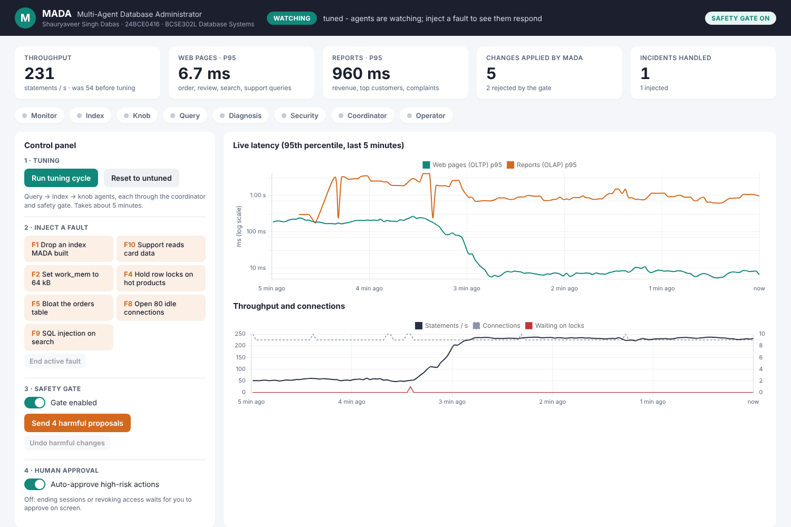

# MADA — Multi-Agent Database Administrator

Shauryaveer Singh Dabas · 24BCE0416 · BCSE302L Database Systems

MADA is a team of six AI agents (monitor, index, knob, query, diagnosis, security) that look after a
PostgreSQL database. The agents never change the database directly: they test every idea on a sandbox
clone and send proposals to a **coordinator** and a **safety gate**, which apply only changes with measured
benefit, ask a person before anything irreversible, and roll back anything that makes the system slower.

This folder contains the full prototype and a **live web dashboard** for demonstrations.



## Final results (one scripted run of this code)

| Measure | Result |
|---|---|
| Complaints report, p95 | 26.4 s → 37 ms |
| Order detail page, p95 | 223 ms → 2.0 ms |
| Throughput | 60 → 240 statements/s (4.0×) |
| Tuning proposals | 4 applied, 2 rejected on sandbox evidence |
| Injected faults (7) | 7 detected within 12.2 s, 7 correctly diagnosed, 7 fixed automatically |
| SQL-injection classifier | precision 1.000, recall 1.000; 0.793 recall on an unseen attack family |
| Safety gate | gate on: 4 of 4 harmful proposals rejected; gate off: 4 of 4 reached production |

**How it works, file by file:** [`docs/PROJECT_GUIDE.md`](docs/PROJECT_GUIDE.md) (also as PDF) explains where each part of the code is,
what the AI in each agent is, how every filter and safety check works, and answers likely review questions.

Full write-up: `docs/reviews/FinalReview_MADA_24BCE0416.pdf` (report) and `.pptx` (slides). Review I and II
documents and slides are in the same folder. Raw data: `results/results.json`, full console log: `results/run_log.txt`.

---

## 1. Run it (recommended: Docker)

Works the same on Windows, macOS and Linux.

1. Install **Docker Desktop** (Windows/macOS) or Docker Engine (Linux) and start it.
2. Open a terminal in this folder and run:

   ```
   docker compose up --build
   ```

   Windows users can double-click `start_demo.bat` instead.
3. Open **http://localhost:8000** in a browser.

The first start downloads the images, builds a 168 MB e-commerce database and its sandbox clone
(about 3–5 minutes in total), then measures the untuned database for one minute. Later starts reuse
the database and are ready in about a minute.

To stop: `Ctrl+C` in the terminal, or `docker compose down`. To delete the database too:
`docker compose down -v`.

## 2. Run it without Docker (Linux)

```
sudo apt install postgresql-16 postgresql-16-hypopg python3-venv
```

In `postgresql.conf` set `shared_preload_libraries = 'pg_stat_statements'` and
`max_connections = 200`, then restart PostgreSQL. Then:

```
python3 -m venv .venv && . .venv/bin/activate
pip install -r requirements.txt
export MADA_PG_HOST=localhost MADA_PG_PORT=5432 MADA_PG_USER=postgres MADA_PG_PASSWORD=<your password>
./start_demo.sh
```

On Windows and macOS, use Docker: HypoPG has no ready-made installer there.

---

## 3. Demo script for the review (about 10 minutes)

**Before the panel arrives** (about 6 minutes): start the project, wait until the status says
**READY**, and leave it running. You can either run the tuning cycle live (step B, about 5 minutes) or
run it before the review and use step B to talk through the result.

**A. The problem (1 min).** Point at the KPI cards and the template table: the database is untuned
(primary keys only, default settings). Web-page queries take hundreds of milliseconds and the complaints
report takes about 20 seconds.

**B. Tuning cycle (5 min, can run while you talk).** Press **Run tuning cycle**. Watch the agent strip
light up and the agent log:
- *Query agent* rewrites the complaints report (correlated subquery → join) and proves the rows are identical.
- *Index agent* costs candidate indexes with HypoPG, then builds each one on the sandbox and times it.
  Watch for **REJECT** rows: a candidate whose real timing does not confirm the estimate is refused
  (in our runs, an index on `reviews(product_id, rating)` that looked useful made the rewritten report slower).
- *Coordinator* defers proposals that touch the same resource and applies one plan change at a time.
- *Knob agent* runs Bayesian optimisation; its small gain is usually **rejected** as below the 20% bar.

The latency chart drops, throughput rises, and the decisions table shows every PASS / REJECT / DEFER
with its reason.

**C. Faults (3 min).** Once the status says **WATCHING**, inject faults one at a time:
- **F4 Hold row locks** → monitor alerts within seconds, diagnosis finds the blocking session, and a
  **human-approval dialog** appears. Press *Approve* — the blocker is ended and orders flow again.
- **F1 Drop an index** → detected, diagnosed as *missing index*, index recreated automatically.
- **F9 SQL injection** → the security agent flags the injected search and asks to end the attacker's session.
- **F10 Support reads card data** → access outside the support role's profile; the grant is revoked.

**D. Safety gate (1 min).** Press **Send 4 harmful proposals** with the gate ON: all four are rejected
(slower on the sandbox, wrong results, out-of-range setting). Switch the gate OFF and send them again:
they reach production. Press **Undo harmful changes** and switch the gate back ON.

**Questions you may get**
- *Is an LLM used?* Optional. This build runs in rule mode; an LLM back-end can be plugged in for
  explanations, behind the same safety gate.
- *Why a sandbox?* Optimiser estimates are often wrong (Ding et al., SIGMOD 2019); MADA measures before it acts.
- *What if two agents want conflicting changes?* The coordinator's resource conflict graph defers one of them.

---

## 4. Troubleshooting

| Problem | Fix |
|---|---|
| Port 8000 already in use | Change `"8000:8000"` in `docker-compose.yml` to e.g. `"8080:8000"` and open http://localhost:8080 |
| Status stays on "waiting for PostgreSQL" | The database container is still starting; it retries for two minutes. Check `docker compose logs db` |
| Everything is slow | Give Docker Desktop at least 2 CPUs and 4 GB of memory (Settings → Resources) |
| Want to start over | Press **Reset to untuned** on the dashboard, or `docker compose down -v` to rebuild the database |

## 5. Reproduce the report's numbers

`python run_experiments.py` (with the same `MADA_PG_*` variables) runs the full scripted evaluation:
before → tuning → after → seven faults → safety-gate ablation. It writes `results/results.json`,
`results/series_*.json` and the screenshots in `screenshots/`. The copies in this folder come from the
run reported in the Final Review.

## 6. Project layout

| Path | What it is |
|---|---|
| `mada/schema.py` | Builds the store database (6 tables, 168 MB), roles and the sandbox clone |
| `mada/workload.py` | Eight sessions replaying ten query templates; audit log |
| `mada/observability.py` | Telemetry collector (every 2 s) |
| `mada/agents/monitor.py` | Baseline, z-score + Isolation Forest alerts, load forecast |
| `mada/agents/index_agent.py` | sqlglot candidates, HypoPG what-if, greedy selection, sandbox timing |
| `mada/agents/knob_agent.py` | Knob catalog + Optuna TPE on the sandbox |
| `mada/agents/query_agent.py` | Rewrite rule R1 and planner hint sets |
| `mada/agents/diagnosis.py` | Predicates, six-cause knowledge base, SQL probes, fix routing |
| `mada/agents/security.py` | SQL-injection classifier and per-role access profiles |
| `mada/coordinator.py` | Coordinator (conflicts, priority) and safety gate |
| `mada/faults.py` | Fault injectors F1–F10 |
| `demo/` | Live dashboard (Flask server + HTML/JS) |
| `run_experiments.py` | Scripted evaluation used for the report |
| `results/`, `screenshots/` | Output of the final evaluation run |
| `docs/PROJECT_GUIDE.md` / `.pdf` | Project guide: code map, the AI in each agent, every filter and safety check, review Q&A |
| `docs/reviews/` | Review I, Review II and Final Review documents (Word + PDF) and slides |

## 7. Settings (environment variables)

| Variable | Default | Meaning |
|---|---|---|
| `MADA_PG_HOST` / `MADA_PG_PORT` | localhost / 5432 | PostgreSQL server |
| `MADA_PG_USER` / `MADA_PG_PASSWORD` | postgres / (empty) | Superuser used by MADA |
| `MADA_DEMO_PORT` | 8000 | Dashboard port |
| `MADA_INDEX_WAIT` | 45 | Seconds of fresh statistics before the index agent runs |
| `MADA_BASELINE_S` | 60 | Seconds of healthy traffic the monitor learns from after tuning |
| `MADA_KNOB_TRIALS` | 10 | Bayesian-optimisation trials |
