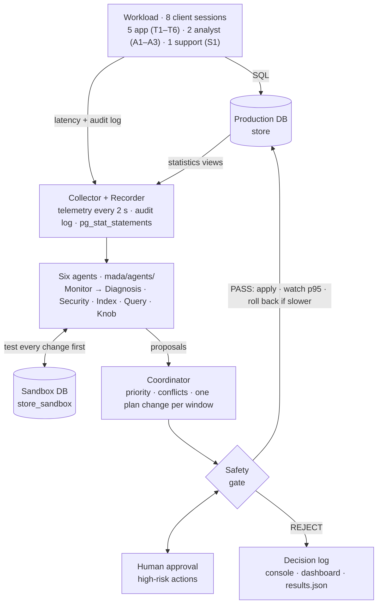
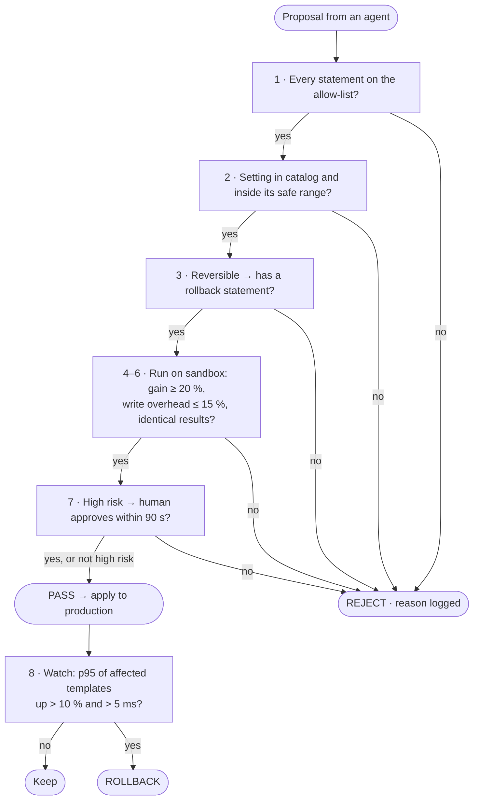

# MADA: Project Guide

**Multi-Agent AI for Autonomous Database Administration**
Shauryaveer Singh Dabas · 24BCE0416 · BCSE302L Database Systems · Topic 11

This guide answers the questions a reviewer is likely to ask about the project:

- where the code is;
- what the AI is;
- how every decision is filtered;
- which database concepts the project uses;
- what the results were.

Each claim links to the exact lines of code on GitHub.

**Contents**

1. [MADA in one minute](#1-mada-in-one-minute)
2. [Where the code is](#2-where-the-code-is)
3. [Architecture and data flow](#3-architecture-and-data-flow)
4. [The test database and workload](#4-the-test-database-and-workload)
5. [What the AI is: agent by agent](#5-what-the-ai-is-agent-by-agent)
6. [How filtering works: every filter, in order](#6-how-filtering-works-every-filter-in-order)
7. [Fault injection: how the agents are tested](#7-fault-injection-how-the-agents-are-tested)
8. [Database concepts used](#8-database-concepts-used)
9. [How to run and demonstrate it](#9-how-to-run-and-demonstrate-it)
10. [Results](#10-results)
11. [Limitations](#11-limitations)
12. [Questions the panel may ask](#12-questions-the-panel-may-ask)

---

## 1. MADA in one minute

A production database needs a database administrator (DBA) to do five things:

- create indexes;
- tune settings;
- fix slow queries;
- notice incidents;
- block attacks.

MADA does this work with **six AI agents**. They watch a live PostgreSQL 16 database while eight client sessions use it:

| Agent | Job |
|---|---|
| Monitor | Learns what normal behaviour looks like and raises an alert when the database departs from it |
| Index | Finds indexes that would make the workload faster |
| Query | Rewrites slow SQL and chooses planner hints |
| Knob | Tunes configuration settings such as `work_mem` |
| Diagnosis | Finds the root cause of an alert and proposes a fix |
| Security | Detects SQL injection and access outside a role's normal behaviour |

**No agent can change the database by itself.** Every agent sends a **proposal**, which contains three things: the SQL to run, the SQL that undoes it, and the evidence for the change. The proposal goes to a **coordinator** and then a **safety gate**. The gate does four things:

1. It tests the change on a **sandbox copy** of the database.
2. It accepts the change only if the measured benefit is large enough.
3. It asks a human before anything risky.
4. It rolls the change back if production becomes slower.

**Results of one scripted run:**

- The slowest report fell from 26.4 s to 37 ms (p95).
- Throughput rose from 60 to 240 statements per second.
- All 7 injected faults were detected within 12.2 s and fixed.
- All 4 deliberately harmful proposals were stopped by the gate.

---

## 2. Where the code is

**GitHub repository:** <https://github.com/svsdlmao/mada-autonomous-db-admin> (branch `main`)

The repository is private. To let the panel open the links in this guide, either add them as collaborators (*Settings → Collaborators*) or make the repository public (*Settings → General → Change visibility*).

**Copy on the presentation laptop:** `C:\Users\dabas\Downloads\mada-autonomous-db-admin`

The project is about 3,300 lines of Python, HTML and JavaScript.

### 2.1 File map

| File | Lines | What it contains |
|---|---:|---|
| [`mada/config.py`](https://github.com/svsdlmao/mada-autonomous-db-admin/blob/main/mada/config.py) | 42 | Every threshold in one place: alert z-score, 20 % gain bar, 15 % write-overhead limit, 10 % rollback rise, 120 MB index budget, priority order. Also the connection settings |
| [`mada/schema.py`](https://github.com/svsdlmao/mada-autonomous-db-admin/blob/main/mada/schema.py) | 118 | Builds the `store` database: 6 tables, 1.7 million rows, 168 MB. Also creates three login roles and their grants, the `mada` registry schema, and the sandbox clone |
| [`mada/workload.py`](https://github.com/svsdlmao/mada-autonomous-db-admin/blob/main/mada/workload.py) | 231 | Eight client threads that replay 10 query templates. Records each statement's latency and writes an audit line for it |
| [`mada/observability.py`](https://github.com/svsdlmao/mada-autonomous-db-admin/blob/main/mada/observability.py) | 114 | The telemetry collector, which runs every 2 s |
| [`mada/core.py`](https://github.com/svsdlmao/mada-autonomous-db-admin/blob/main/mada/core.py) | 67 | The `Proposal` data class, the event log and the optional LLM back-end |
| [`mada/agents/monitor.py`](https://github.com/svsdlmao/mada-autonomous-db-admin/blob/main/mada/agents/monitor.py) | 96 | Baseline, z-scores, Isolation Forest, load forecast |
| [`mada/agents/index_agent.py`](https://github.com/svsdlmao/mada-autonomous-db-admin/blob/main/mada/agents/index_agent.py) | 245 | Candidate extraction with sqlglot, HypoPG what-if costing, greedy selection, timing on the sandbox |
| [`mada/agents/query_agent.py`](https://github.com/svsdlmao/mada-autonomous-db-admin/blob/main/mada/agents/query_agent.py) | 161 | Rewrite rule R1 and the planner hint sets |
| [`mada/agents/knob_agent.py`](https://github.com/svsdlmao/mada-autonomous-db-admin/blob/main/mada/agents/knob_agent.py) | 134 | Knob catalog and Bayesian optimisation with Optuna TPE |
| [`mada/agents/diagnosis.py`](https://github.com/svsdlmao/mada-autonomous-db-admin/blob/main/mada/agents/diagnosis.py) | 153 | Predicates, the six-cause knowledge base, SQL probes, fix routing |
| [`mada/agents/security.py`](https://github.com/svsdlmao/mada-autonomous-db-admin/blob/main/mada/agents/security.py) | 146 | SQL-injection classifier and per-role access profiles |
| [`mada/coordinator.py`](https://github.com/svsdlmao/mada-autonomous-db-admin/blob/main/mada/coordinator.py) | 178 | Statement allow-list, safety gate, and the coordinator (priority, conflicts, apply, watch, rollback) |
| [`mada/faults.py`](https://github.com/svsdlmao/mada-autonomous-db-admin/blob/main/mada/faults.py) | 172 | The seven fault injectors used in testing |
| [`mada/dashboard.py`](https://github.com/svsdlmao/mada-autonomous-db-admin/blob/main/mada/dashboard.py) | 62 | Saves console screenshots and the fault-timeline chart |
| [`run_experiments.py`](https://github.com/svsdlmao/mada-autonomous-db-admin/blob/main/run_experiments.py) | 348 | The scripted evaluation that produced every number in the report |
| [`demo/server.py`](https://github.com/svsdlmao/mada-autonomous-db-admin/blob/main/demo/server.py) | 667 | Flask server for the live dashboard. It runs the same agents as the scripted evaluation |
| [`demo/static/`](https://github.com/svsdlmao/mada-autonomous-db-admin/tree/main/demo/static) | 334 | The dashboard page: HTML, CSS, JavaScript and Chart.js |
| `Dockerfile`, `docker/db.Dockerfile`, `docker-compose.yml` | – | Two containers: PostgreSQL 16 with HypoPG, and the MADA application |
| `results/` | – | `results.json` (every number), `run_log.txt` (the full console log), and time series |
| `screenshots/` | – | 15 console screenshots from the run |
| `docs/reviews/` | – | Review I, Review II and the Final Review, each as Word, PDF and slides |

### 2.2 Software used

| Part | Technology | Used for |
|---|---|---|
| Database | PostgreSQL 16.15 | The database being administered |
| Extension | `pg_stat_statements` | Execution statistics for each query (which queries are expensive) |
| Extension | HypoPG | Hypothetical indexes for what-if costing |
| Database driver | psycopg 3.3 | All database access from Python |
| SQL parser | sqlglot 30 | Reading queries (to find index candidates) and rewriting them (rule R1) |
| Machine learning | scikit-learn 1.9 | Isolation Forest, linear regression, TF-IDF with logistic regression |
| Optimisation | Optuna 5.0 (TPE sampler) | Bayesian search over configuration settings |
| Web | Flask 3.1, Chart.js 4.4 | The live dashboard |
| Packaging | Docker Compose | Starting everything with one command on any laptop |

---

## 3. Architecture and data flow



**What each agent reads**

| Agent | Reads |
|---|---|
| Monitor | The collector's telemetry row every 2 s |
| Diagnosis | The monitor's alert, the telemetry before and during the fault, and its own SQL probes |
| Security | The audit log: role, template and SQL text of every statement |
| Index | `pg_stat_statements` (which queries cost the most time) |
| Query | The recorder's latencies (which analytical templates are slow) |
| Knob | The recorder's call frequencies (how often each template runs) |

**Components**

- **Production database `store`.** The database MADA looks after.
- **Sandbox `store_sandbox`.** A full copy, made with `CREATE DATABASE store_sandbox TEMPLATE store` ([`schema.py` L108–118](https://github.com/svsdlmao/mada-autonomous-db-admin/blob/main/mada/schema.py#L108-L118)). Agents try their ideas here, so production is never used for experiments.
- **Workload.** Eight threads, each logged in as a real PostgreSQL role ([`workload.py` L182–201](https://github.com/svsdlmao/mada-autonomous-db-admin/blob/main/mada/workload.py#L182-L201)).
- **Recorder.** Keeps two records for every statement:
  - a sample: time, template, latency and success;
  - an audit line: time, role, template and SQL text.
- **Collector.** Builds one row of telemetry every 2 s.
- **Dashboard.** Reads the same state through `/api/state` and `/api/log`.

### 3.1 Life of a proposal

1. **An agent finds something to improve and builds a `Proposal`** ([`core.py` L20–44](https://github.com/svsdlmao/mada-autonomous-db-admin/blob/main/mada/core.py#L20-L44)):

   | Field | Meaning |
   |---|---|
   | `agent`, `category` | Who proposes it, and whether it is security, availability, correctness or performance |
   | `action_sql`, `rollback_sql` | The SQL to run, and the SQL that undoes it |
   | `resources` | What it touches, for example `table:orders`, `planner`, `memory`, `session:1234` |
   | `risk`, `reversible` | `low` / `medium` / `high`, and whether it can be undone |
   | `evidence`, `predicted_gain` | The measurements behind it |
   | `templates` | The queries whose latency it should change |
   | `sandbox_check` | A function that measures the change on the sandbox |

2. **The coordinator collects the proposals of one window.** It sorts them and defers any that conflict ([§6.8](#68-coordinator)).
3. **The safety gate runs its checks** ([§6.9](#69-safety-gate)). On PASS, the SQL runs on production. Index and registry changes are mirrored to the sandbox so the copy stays in step.
4. **For performance changes, the coordinator watches production for 12–15 s.** It compares the p95 of the affected templates in the 60 s before the change with the p95 after it. It rolls the change back if p95 rose by more than 10 % and by more than 5 ms ([`coordinator.py` L164–176](https://github.com/svsdlmao/mada-autonomous-db-admin/blob/main/mada/coordinator.py#L164-L176)).
5. **Every decision is logged with its reason.** The log appears in the console, on the dashboard and in `results.json`.

### 3.2 The two loops

**Tuning cycle.** Runs when you press the button on the dashboard ([`server.py` L246–298](https://github.com/svsdlmao/mada-autonomous-db-admin/blob/main/demo/server.py#L246-L298)) or in `run_experiments.py`:

1. The query agent proposes changes, then a coordinator window decides on them.
2. `pg_stat_statements` is reset and 45 s of fresh statistics are collected.
3. The index agent proposes indexes. Coordinator windows run until nothing is deferred.
4. The knob agent proposes settings, then a coordinator window decides on them.
5. The monitor learns 60 s of normal behaviour. Then the monitor, diagnosis and security agents are armed.

**Incident loop.** Runs every 2 s ([`server.py` L394–424](https://github.com/svsdlmao/mada-autonomous-db-admin/blob/main/demo/server.py#L394-L424)):

1. The security agent scans the new audit lines.
2. The monitor checks the latest telemetry row.
3. On an alert, the diagnosis agent finds the cause and builds a fix, and the fix goes to the coordinator and gate.

### 3.3 How an approved change reaches the application

Indexes and settings act directly on the database. Query rewrites and planner hints are different, because PostgreSQL has no built-in place to store them. MADA therefore keeps a registry of approved changes in two tables, `mada.rewrites` and `mada.hints` ([`schema.py` L15–32](https://github.com/svsdlmao/mada-autonomous-db-admin/blob/main/mada/schema.py#L15-L32)).

- The workload re-reads the registry every 2 s ([`workload.py` L104–115](https://github.com/svsdlmao/mada-autonomous-db-admin/blob/main/mada/workload.py#L104-L115)).
- For a template that is in the registry, the workload runs the approved SQL text, or sets the approved hints with `SET LOCAL` inside the transaction ([`workload.py` L117–136](https://github.com/svsdlmao/mada-autonomous-db-admin/blob/main/mada/workload.py#L117-L136)).

This stands in for the hint table of the `pg_hint_plan` extension, or for a query registry inside the application.

---

## 4. The test database and workload

**Tables** ([`schema.py` L15–32](https://github.com/svsdlmao/mada-autonomous-db-admin/blob/main/mada/schema.py#L15-L32)). At the start the database is untuned: only primary keys exist, and every setting is the PostgreSQL default.

| Table | Rows | Notes |
|---|---:|---|
| customers | 50,000 | city, segment |
| products | 5,000 | 8 categories, price, stock |
| orders | 300,000 | customer, date, status, total |
| order_items | 900,081 | order, product, quantity, price |
| reviews | 150,000 | product, rating 1–5, date, text |
| payments | 300,000 | method, `card_last4` (sensitive) |
| **Total** | **1.7 M** | **168 MB** |

**Roles** ([`schema.py` L34–41](https://github.com/svsdlmao/mada-autonomous-db-admin/blob/main/mada/schema.py#L34-L41))

| Role | Sessions | Granted | Actually uses |
|---|---:|---|---|
| `app_user` | 5 | SELECT, INSERT, UPDATE on all six tables | T1–T6 |
| `analyst` | 2 | SELECT on all tables | A1–A3 |
| `support` | 1 | SELECT on customers, orders, order_items, products, payments | S1 only (customers, orders) |

The `support` role is *granted* access to `payments` but never reads it. This kind of over-granting is common in real systems. The security agent learns which tables each role actually uses, so a read of `payments` by `support` stands out (fault F10).

**Query templates** ([`workload.py` L20–54](https://github.com/svsdlmao/mada-autonomous-db-admin/blob/main/mada/workload.py#L20-L54))

| ID | What it does | Why it matters |
|---|---|---|
| T1 order history | `orders WHERE customer_id = ? ORDER BY order_date DESC LIMIT 20` | Needs an index on `(customer_id, order_date)` |
| T2 order detail | `order_items JOIN products WHERE order_id = ?` | Needs an index on `order_items(order_id)` |
| T3 product reviews | `reviews WHERE product_id = ? ORDER BY review_date DESC LIMIT 10` | Needs an index on `(product_id, review_date)` |
| T4 place order | A transaction: insert the order, update stock on 50 popular products, insert the items and the payment | The write path. Holds row locks |
| T5 product search | `name ILIKE '%term%'`, **built by string concatenation** ([L161–163](https://github.com/svsdlmao/mada-autonomous-db-admin/blob/main/mada/workload.py#L161-L163)) | The deliberately injectable endpoint, like a careless web form |
| T6 product lookup | Primary-key lookup | Already fast; serves as a control |
| A1 revenue by category | Join of three tables, grouped by month | Large hash joins; sensitive to `work_mem` |
| A2 top customers per city | Join and aggregate | Analytical query |
| A3 complaints report | A correlated `COUNT(*)` subquery for each product | 26 s. The target of rewrite R1 |
| S1 support lookup | `customers JOIN orders WHERE customer_id = ?` | Needs an index that starts with `orders(customer_id …)` |

---

## 5. What the AI is: agent by agent

In MADA, "AI" covers four kinds of technique, each used where it fits best:

- **Machine learning from data.** Isolation Forest (unsupervised anomaly detection), linear regression (load forecast), and TF-IDF with logistic regression (supervised classification).
- **Optimisation and search.** Bayesian optimisation (TPE), a greedy what-if search over indexes, and a search over planner hint sets.
- **Knowledge-based reasoning.** A diagnosis knowledge base checked with SQL probes, and rewriting of queries on their parse tree using rules.
- **Multi-agent coordination.** Independent agents, a coordinator that resolves conflicts between them, and a safety gate that verifies every action.

| Agent | Technique | Kind | Library | Based on |
|---|---|---|---|---|
| Monitor | z-score baseline with an Isolation Forest; linear-regression load forecast | Unsupervised ML, regression | scikit-learn | Isolation Forest (Liu et al.); QueryBot 5000 (forecasting) |
| Index | Candidate extraction, HypoPG what-if costs, greedy benefit-per-MB selection, real timing on the sandbox | Search with verification | sqlglot, HypoPG | Extend (Schlosser et al.); *AI Meets AI* (Ding et al.) |
| Query | Rewrite rule R1 on the parse tree, 6 planner hint sets, check that results are identical | Rule-based reasoning and search | sqlglot | LLM-R2 (rule-based rewriting); Bao (hint sets) |
| Knob | Bayesian optimisation (TPE) over 6 catalogued settings | Optimisation | Optuna | OtterTune; GPTuner (knob catalog) |
| Diagnosis | Predicates, a knowledge base and SQL probes | Knowledge-based reasoning | numpy | DBSherlock; D-Bot |
| Security | TF-IDF character n-grams with logistic regression; access profiles for each role | Supervised ML and behaviour profiling | scikit-learn | Kamra, Terzi & Bertino |

Full references are in the Final Review (`docs/reviews/FinalReview_MADA_24BCE0416.pdf`).

**About the LLM.** The LLM back-end is optional ([`core.py` L47–64](https://github.com/svsdlmao/mada-autonomous-db-admin/blob/main/mada/core.py#L47-L64)).

- Without an `ANTHROPIC_API_KEY`, the system runs in *rule mode*. **Every result in this project was produced in rule mode.**
- With a key set, the LLM only writes the wording of the diagnosis explanation. It never writes SQL and never makes a decision.

This is deliberate. The research systems MADA draws on (LLM-R2, GPTuner, D-Bot) use LLMs to *suggest*, and suggestions can be wrong. MADA keeps every action checkable: it comes from a fixed rule or a measured search, and it passes the same gate.

### 5.1 Monitor agent ([`monitor.py`](https://github.com/svsdlmao/mada-autonomous-db-admin/blob/main/mada/agents/monitor.py))

**What it watches.** 15 metrics ([L10–16](https://github.com/svsdlmao/mada-autonomous-db-admin/blob/main/mada/agents/monitor.py#L10-L16)). Each metric has a "bad" direction (for example, throughput is bad when it goes *down*).

| Group | Metrics |
|---|---|
| Latency and throughput | p95 OLTP latency, p95 OLAP latency, statements per second, errors per second |
| Locks | Sessions waiting on a lock, ungranted locks |
| Connections | Total connections, idle connections |
| Resources | Temporary bytes written per second, CPU |
| Tables | Dead rows in `orders` and `order_items`; rows read by sequential scans per second on three tables |

**How it learns** (`fit_baseline`, [L28–39](https://github.com/svsdlmao/mada-autonomous-db-admin/blob/main/mada/agents/monitor.py#L28-L39)). After tuning, it records 60 s of healthy traffic, about 28 telemetry rows. From these rows it builds two models:

- **For each metric, a mean and a standard deviation.** The standard deviation is given a floor: at least 15 % of the mean, and at least 1. Without the floor, a metric that hardly moved during training would produce an enormous z-score for a tiny change.
- **An Isolation Forest** (100 trees, 2 % contamination), trained on all metrics together. It learns what a normal *combination* of values looks like.

> **How an Isolation Forest works.** Each tree splits the data on a random metric at a random value, again and again. An unusual point ends up alone after only a few splits, so a short average path through the trees means "anomaly". A negative `decision_function` value marks the point as anomalous.

**How it alerts.** The alert rule is described in [§6.2](#62-alert-filter-monitor).

**Forecast** ([L77–96](https://github.com/svsdlmao/mada-autonomous-db-admin/blob/main/mada/agents/monitor.py#L77-L96)). For each template, the monitor counts calls in 10-second buckets over the last 120 s. It fits a straight line to the counts and predicts the arrival rate 60 s ahead. The forecast is reported in the scripted run (`results.json → forecast`). In this prototype no other agent uses it yet; the knob agent weights templates by the frequency measured over the last minute.

### 5.2 Index agent ([`index_agent.py`](https://github.com/svsdlmao/mada-autonomous-db-admin/blob/main/mada/agents/index_agent.py))

1. **Find what is expensive** (`top_queries`, [L97–103](https://github.com/svsdlmao/mada-autonomous-db-admin/blob/main/mada/agents/index_agent.py#L97-L103)). Read `pg_stat_statements`, order the queries by total execution time, remove queries that are not part of the workload ([§6.5](#65-index-agent-filters)), and keep the top 10.
2. **Generate candidates** (`extract_candidates`, [L42–83](https://github.com/svsdlmao/mada-autonomous-db-admin/blob/main/mada/agents/index_agent.py#L42-L83)).
   - Parse each query with sqlglot.
   - Collect the columns that appear in equality predicates, range predicates and `ORDER BY`, and resolve each to its table through the aliases.
   - Propose one single-column index for each such column.
   - Propose two-column indexes of the form *(equality column, order-by column)* and *(equality column, range column)*.
3. **What-if costing** (`whatif`, [L114–158](https://github.com/svsdlmao/mada-autonomous-db-admin/blob/main/mada/agents/index_agent.py#L114-L158)).
   - For each candidate, HypoPG creates a *hypothetical* index. It costs no disk space and takes no time to build.
   - The agent re-runs `EXPLAIN (GENERIC_PLAN)` on each expensive query and reads the planner's estimated total cost.
   - The benefit of a candidate is:

     benefit = Σ<sub>q</sub> w<sub>q</sub> · (cost<sub>before</sub> − cost<sub>after</sub>) / cost<sub>before</sub>

     where w<sub>q</sub> is query q's share of total execution time.
4. **Greedy selection, as in the *Extend* algorithm.**
   - Pick the candidate with the best benefit per MB and keep it in place.
   - Repeat until no candidate improves the weighted cost by more than 1 %, or the 120 MB budget is used up.
   - Drop any pick whose columns are a prefix of another pick on the same table.
5. **Prove it on the sandbox** (`sandbox_check`, [L188–209](https://github.com/svsdlmao/mada-autonomous-db-admin/blob/main/mada/agents/index_agent.py#L188-L209)).
   - Build the index for real on the sandbox.
   - Time the affected templates before and after: the median of 7 runs, or of 3 runs for slow queries. The timing uses the SQL that production actually runs, including any approved rewrites.
   - Time the write path three times: before the index, with it, and after dropping it again (A/B/A). Each measurement is the 20th percentile of 80 order transactions that are rolled back, so no test data is left behind.
6. **Propose.** The action is `CREATE INDEX CONCURRENTLY mada_<table>_<columns>` and the rollback is `DROP INDEX CONCURRENTLY`. The resources are the table, `disk` and `planner`. The risk is low.

**Why both estimate and measure?** The planner's estimates are often wrong. In this run the planner estimated that an index on `orders(order_date)` would cut the weighted cost by 21.7 %. On the sandbox the same index made the support lookup 9 times slower (74 → 680 ms), so the gate rejected it.

### 5.3 Query agent ([`query_agent.py`](https://github.com/svsdlmao/mada-autonomous-db-admin/blob/main/mada/agents/query_agent.py))

**Which queries.** Analytical templates whose mean latency over the last 60 s is above 250 ms.

**Rewrite rule R1** (`rule_decorrelate_count`, [L28–67](https://github.com/svsdlmao/mada-autonomous-db-admin/blob/main/mada/agents/query_agent.py#L28-L67)). R1 works on the sqlglot *syntax tree*, not on the SQL text.

1. It looks for a scalar subquery in the `SELECT` list that returns `COUNT(*)` and is correlated to the outer query through an equality `inner.col = outer.col`.
2. It turns the subquery into a derived table, grouped by the inner column, that keeps the subquery's other filters.
3. It `LEFT JOIN`s that table on the correlation column.
4. It wraps the count in `COALESCE(cnt, 0)`, so products with no matching rows still show 0.

```sql
-- before: the inner query runs once per product (26.4 s at p95)
SELECT p.product_id, p.name,
       (SELECT count(*) FROM reviews r
        WHERE r.product_id = p.product_id AND r.rating <= 2) AS bad_reviews
FROM products p WHERE p.category = %s
ORDER BY bad_reviews DESC, p.product_id LIMIT 20

-- after R1: reviews is scanned once and grouped (37 ms at p95)
SELECT p.product_id, p.name, COALESCE(d.cnt, 0) AS bad_reviews
FROM products AS p
LEFT JOIN (SELECT r.product_id AS k, COUNT(*) AS cnt FROM reviews AS r
           WHERE r.rating <= 2 GROUP BY r.product_id) AS d ON d.k = p.product_id
WHERE p.category = %s ORDER BY bad_reviews DESC, p.product_id LIMIT 20
```

**Why the rewrite is correct.** `COUNT(*)` over an empty set is 0. The `LEFT JOIN` keeps every product, and `COALESCE` turns a missing count into 0. So both queries return the same rows. This is the classic decorrelation (unnesting) of a correlated subquery. MADA does not rely on that argument alone: it also runs both versions on 3 parameter samples on the sandbox and compares the full result rows ([L106](https://github.com/svsdlmao/mada-autonomous-db-admin/blob/main/mada/agents/query_agent.py#L106)).

**Planner hint sets** ([L14–17](https://github.com/svsdlmao/mada-autonomous-db-admin/blob/main/mada/agents/query_agent.py#L14-L17)), in the style of Bao.

- There are six alternatives: no nested-loop joins, no hash joins, no merge joins, no sequential scans, no JIT, and no nested-loop or merge joins.
- Each is applied with `SET LOCAL` and timed as the median of 3 runs.
- The hint search is skipped when a rewrite already removes more than 90 % of a query that takes over 5 s ([L108–110](https://github.com/svsdlmao/mada-autonomous-db-admin/blob/main/mada/agents/query_agent.py#L108-L110)).

**Choice and output.**

- The agent picks the fastest option that returns identical results, and only if it beats the default plan by at least 20 % ([L138](https://github.com/svsdlmao/mada-autonomous-db-admin/blob/main/mada/agents/query_agent.py#L138)).
- The proposal is an `INSERT` into `mada.rewrites` or `mada.hints`; the rollback is a `DELETE`.
- A rewrite is medium risk. A hint is low risk.

### 5.4 Knob agent ([`knob_agent.py`](https://github.com/svsdlmao/mada-autonomous-db-admin/blob/main/mada/agents/knob_agent.py))

**Knob catalog** ([L18–25](https://github.com/svsdlmao/mada-autonomous-db-admin/blob/main/mada/agents/knob_agent.py#L18-L25)). Six settings. Each entry records the setting's documented meaning, its type, a safe range and its default. All six can be changed with a reload, without restarting the server.

| Setting | Safe range |
|---|---|
| `work_mem` | 1–256 MB |
| `hash_mem_multiplier` | 1–8 |
| `random_page_cost` | 1.1–4.0 |
| `effective_cache_size` | 1–6 GB |
| `max_parallel_workers_per_gather` | 0–2 |
| `jit` | on / off |

This catalog plays the role of GPTuner's "read the manual" step. Here it is curated by hand from the PostgreSQL 16 documentation.

**Objective** (`_replay`, [L50–71](https://github.com/svsdlmao/mada-autonomous-db-admin/blob/main/mada/agents/knob_agent.py#L50-L71)).

- On the sandbox, the candidate configuration is applied with `SET` in the session.
- Seven templates are replayed, 2–5 runs each, using the SQL that production runs.
- The value to minimise is Σ (production calls per minute × median latency).

**Search** ([L97–99](https://github.com/svsdlmao/mada-autonomous-db-admin/blob/main/mada/agents/knob_agent.py#L97-L99)).

- The search uses Optuna's TPE sampler: 14 trials in the scripted run and 10 in the live demo. The first trial is always the default configuration.
- TPE splits past trials into "good" and "bad" ones and models each group as a probability density. It then tries the configuration where the ratio of good to bad is highest. Unlike grid or random search, it learns from earlier trials.

**Output.** The action is `ALTER SYSTEM SET …; SELECT pg_reload_conf()` and the rollback is `ALTER SYSTEM RESET …`. If the best configuration is the default one, the agent makes no proposal. That is what happened in this run ([L106–110](https://github.com/svsdlmao/mada-autonomous-db-admin/blob/main/mada/agents/knob_agent.py#L106-L110)).

**`repair()`** ([L125–134](https://github.com/svsdlmao/mada-autonomous-db-admin/blob/main/mada/agents/knob_agent.py#L125-L134)) restores a setting to its last known-good value. The diagnosis agent uses it for fault F2.

### 5.5 Diagnosis agent ([`diagnosis.py`](https://github.com/svsdlmao/mada-autonomous-db-admin/blob/main/mada/agents/diagnosis.py))

The diagnosis agent works in three steps.

1. **Predicates, as in DBSherlock** ([L13–19](https://github.com/svsdlmao/mada-autonomous-db-admin/blob/main/mada/agents/diagnosis.py#L13-L19), [L92–99](https://github.com/svsdlmao/mada-autonomous-db-admin/blob/main/mada/agents/diagnosis.py#L92-L99)). For each metric it computes

   separation = (mean during the anomaly − mean before it) / standard deviation before it

   and keeps the metrics whose separation is at least 3σ in either direction.

2. **Knowledge base** ([L22–30](https://github.com/svsdlmao/mada-autonomous-db-admin/blob/main/mada/agents/diagnosis.py#L22-L30)). Six causes, each with a metric signature, a probe (a SQL check that confirms the cause), and the agent that owns the fix:

   | Cause | Signature (metrics that rise) | Probe confirms when… | Fix |
   |---|---|---|---|
   | Lock contention | lock waits, ungranted locks, T4 latency | `pg_blocking_pids` finds a blocking session | End the blocking session (high risk) |
   | `work_mem` spill | temporary bytes per second, OLAP latency, A1 latency | `work_mem` is below 4 MB | Knob agent restores the known-good value |
   | Missing index | sequential-scan rows on orders, order_items and reviews; OLTP latency | An index MADA created is missing from `pg_indexes` | Recreate it `CONCURRENTLY` |
   | Table bloat | dead rows in orders and order_items; OLTP latency | Dead rows ≥ 10,000 and more than 20 % of live rows | Re-enable autovacuum and run `VACUUM (ANALYZE)` |
   | Connection storm | connections, idle connections | One role has more than 20 idle sessions | End sessions idle for more than 5 s (high risk) |
   | CPU saturation | CPU, OLTP latency; throughput falls | 1-minute load average > 1.5 × normal + 1 | None (outside the database) |

3. **Scoring and ranking** ([L103–109](https://github.com/svsdlmao/mada-autonomous-db-admin/blob/main/mada/agents/diagnosis.py#L103-L109)).

   score = average over the signature metrics of min(10, max(0, direction × separation))

   If the probe confirms the cause, the score becomes score × 1.5 + 2. **Causes confirmed by their probe rank above every unconfirmed cause.** Within each group, causes are ranked by score.

**Fix routing** (`fix`, [L124–153](https://github.com/svsdlmao/mada-autonomous-db-admin/blob/main/mada/agents/diagnosis.py#L124-L153)). The top cause's fix is built by the agent that owns it. The explanation text comes from the knowledge base in rule mode, or from the LLM when one is configured.

### 5.6 Security agent ([`security.py`](https://github.com/svsdlmao/mada-autonomous-db-admin/blob/main/mada/agents/security.py))

The security agent has two detectors.

**(a) SQL-injection classifier**

- **Training data** (`dataset`, [L34–49](https://github.com/svsdlmao/mada-autonomous-db-admin/blob/main/mada/agents/security.py#L34-L49)). The code generates the data itself. Every example is the complete SQL statement the search endpoint would build.
  - 1,500 benign searches: 1–3 random product words, sometimes with a number or hyphens.
  - 700 attacks: 5 families of 140 each — tautology, `UNION`, stacked queries, time-based, and error-based ([L16–23](https://github.com/svsdlmao/mada-autonomous-db-admin/blob/main/mada/agents/security.py#L16-L23)).
  - Random disguises: each attack has a 30 % chance of spaces replaced by `/**/` comments, and a 30 % chance of random letter case.
- **Features.** TF-IDF over character n-grams of 2–5 characters (`char_wb`). These n-grams capture fragments such as `' or '`, `union sel`, `--` and `/**/`. The text is lower-cased first, so the random letter case does not help an attacker hide.
- **Model.** Logistic regression with balanced class weights. It outputs the probability that a statement is an attack.

```python
pipe = make_pipeline(TfidfVectorizer(analyzer="char_wb", ngram_range=(2, 5), min_df=2),
                     LogisticRegression(max_iter=2000, class_weight="balanced"))
```

- **Evaluation** (`train`, [L61–86](https://github.com/svsdlmao/mada-autonomous-db-admin/blob/main/mada/agents/security.py#L61-L86)).
  - On a 70/30 random split (660 test statements): precision 1.000 and recall 1.000, with 442 true negatives, 218 true positives, and no false positives or false negatives.
  - A harder test leaves the time-based family out of training and tests on it: precision 1.000, recall 0.793. The model partly recognises attack styles it has never seen.

**(b) Access profiles** (`learn_profiles`, [L92–105](https://github.com/svsdlmao/mada-autonomous-db-admin/blob/main/mada/agents/security.py#L92-L105))

- During the 60 s learning window, the agent records the set of tables each role touched. Table names are taken from `FROM`, `JOIN`, `INTO` and `UPDATE` in the audit log.
- For `support`, the profile is {customers, orders}.

**Response** (`respond`, [L122–146](https://github.com/svsdlmao/mada-autonomous-db-admin/blob/main/mada/agents/security.py#L122-L146))

- **Injection:** end the sessions that are currently running injection-like SQL (`pg_terminate_backend`). This is high risk and cannot be undone, so a human must approve it.
- **Abnormal access:** `REVOKE SELECT` on the table from the role, and end the role's sessions. This is high risk but reversible with `GRANT`.

---

## 6. How filtering works: every filter, in order

Data and decisions are filtered at nine points. Each later filter receives only what the earlier ones let through.

| # | Where | What is filtered | Rule | Code |
|---:|---|---|---|---|
| 1 | Collector | Which activity counts | Only client sessions of `store`; only user tables; counters turned into rates over 10 s | [`observability.py` L31–87](https://github.com/svsdlmao/mada-autonomous-db-admin/blob/main/mada/observability.py#L31-L87) |
| 2 | Monitor | Which readings become alerts | z > 4 for 2 ticks in a row **and** the Isolation Forest agrees; or z > 12 alone | [`monitor.py` L53–72](https://github.com/svsdlmao/mada-autonomous-db-admin/blob/main/mada/agents/monitor.py#L53-L72) |
| 3 | Diagnosis | Which metrics count as evidence; which cause is trusted | Separation ≥ 3σ from the window before the fault; confirmed causes first; no automatic fix without confirmation | [`diagnosis.py` L89–127](https://github.com/svsdlmao/mada-autonomous-db-admin/blob/main/mada/agents/diagnosis.py#L89-L127) |
| 4 | Security | Which statements are screened and flagged | Only T5 is screened; flagged when P(attack) > 0.5; access flagged when a table is outside the role's profile | [`security.py` L107–120](https://github.com/svsdlmao/mada-autonomous-db-admin/blob/main/mada/agents/security.py#L107-L120) |
| 5 | Index agent | Which queries, candidates and picks | Workload queries only; user tables; no duplicate leading column; gain > 1 %; 120 MB budget; prefix pruning; template match > 0.9 | [`index_agent.py`](https://github.com/svsdlmao/mada-autonomous-db-admin/blob/main/mada/agents/index_agent.py) |
| 6 | Query agent | Which templates and alternatives | Analytical templates with mean > 250 ms; identical results; at least 20 % faster | [`query_agent.py`](https://github.com/svsdlmao/mada-autonomous-db-admin/blob/main/mada/agents/query_agent.py) |
| 7 | Knob agent | Which settings and values | Catalog only; safe ranges; no proposal if the default wins | [`knob_agent.py`](https://github.com/svsdlmao/mada-autonomous-db-admin/blob/main/mada/agents/knob_agent.py) |
| 8 | Coordinator | Which proposals go together | Priority order; proposals that share a resource are deferred | [`coordinator.py` L119–137](https://github.com/svsdlmao/mada-autonomous-db-admin/blob/main/mada/coordinator.py#L119-L137) |
| 9 | Safety gate | Which proposals reach production | allow-list → catalog and range → rollback present → ≥ 20 % gain → ≤ 15 % write overhead → identical results → human approval → watch and roll back | [`coordinator.py` L45–92](https://github.com/svsdlmao/mada-autonomous-db-admin/blob/main/mada/coordinator.py#L45-L92) |

### 6.1 Telemetry filter (collector)

Every 2 s the collector reads `pg_stat_database`, `pg_stat_activity`, `pg_locks` and `pg_stat_user_tables`, plus CPU from `/proc/stat` ([L31–50](https://github.com/svsdlmao/mada-autonomous-db-admin/blob/main/mada/observability.py#L31-L50)).

- **Only real client sessions count.** Connections are counted only for the `store` database and only where `backend_type = 'client backend'`. PostgreSQL's own background processes and MADA's sandbox work are ignored.
- **Counters become rates over a 10-second window, not 2 s** ([L61](https://github.com/svsdlmao/mada-autonomous-db-admin/blob/main/mada/observability.py#L61)). Counters include commits, temporary bytes and sequential-scan rows. One analytical query writing a temporary file would otherwise make the rate flicker between zero and a huge value from one tick to the next.
- **Latency is measured on the client side.** p95 is taken from the recorder over the same 10 s window, separately for OLTP (T and S templates) and OLAP (A templates).

### 6.2 Alert filter (monitor)

```python
z = self.zscores(row)                                   # direction-aware z-score per metric
bad = {k: v for k, v in z.items() if v > C.ALERT_Z}     # ALERT_Z = 4
iso = float(self.forest.decision_function([[row.get(k, 0.0) for k in self.keys]])[0])
if bad and (iso < 0 or max(bad.values()) > 3 * C.ALERT_Z):
    self.streak += 1
else:
    self.streak = 0
if self.streak >= C.ALERT_CONSECUTIVE:                  # 2 ticks = 4 s
    ...raise one alert
```

What each part filters out:

- **Changes in the harmless direction.** The z-score is direction-aware. If throughput *rises*, that is not an alert.
- **Tiny changes to metrics that barely moved in training.** The standard-deviation floor of max(15 % of the mean, 1) stops these from looking huge.
- **One-off spikes.** The condition must hold for 2 consecutive ticks (4 s). A single slow analytical query does not trigger an alert.
- **One odd metric while the overall picture is normal.** The Isolation Forest must agree that the combination of all metrics is unusual.
- **Exception: extreme values (z > 12) count on their own.** An Isolation Forest cannot split on a metric that never varied during training, such as dead rows or idle connections. Without this exception, faults F5 (bloat) and F8 (connection storm) were missed.
- **Repeat alerts.** After an alert the streak is set to a large negative number. The monitor is re-armed (`reset()`) only when the fault ends, so each incident produces one alert.

### 6.3 Diagnosis filters

- **Compared with the right reference.** If at least 5 telemetry rows exist from the 16 s before the fault, the anomaly is compared with that window. Otherwise it is compared with the long baseline ([L92](https://github.com/svsdlmao/mada-autonomous-db-admin/blob/main/mada/agents/diagnosis.py#L92)). This stops leftovers of an earlier incident from looking new. In development, leftover dead rows from F5 made the next fault, F8, look like bloat until this filter was added.
- **Weak signals are dropped.** Only metrics with a separation of at least 3σ count as evidence.
- **No single metric can dominate.** Each metric contributes at most 10 to a cause's score. For example, dead rows rising a thousandfold cannot outvote everything else.
- **A guess is never acted on as a fact.** A cause confirmed by its SQL probe always outranks an unconfirmed one. If even the top cause is unconfirmed, `fix()` returns nothing, and the log reads *"no automatic fix, operator informed"* ([L125–127](https://github.com/svsdlmao/mada-autonomous-db-admin/blob/main/mada/agents/diagnosis.py#L125-L127)).
- **Probe thresholds:**
  - bloat: dead rows ≥ 10,000 and more than 20 % of live rows;
  - idle connections: more than 20 for one role;
  - `work_mem`: below 4 MB;
  - CPU: load more than 1.5 × normal + 1.

### 6.4 Security filters

- **Only T5 is screened by the classifier** ([L109](https://github.com/svsdlmao/mada-autonomous-db-admin/blob/main/mada/agents/security.py#L109)).
  - T5 is the only endpoint that builds SQL by gluing user input into the string.
  - Every other template uses bound parameters (`%s`). The driver sends those values separately from the SQL, so user input cannot change the structure of the statement, and injection is impossible.
  - Screening those statements would only produce false alarms. An earlier version screened every statement, and the classifier flagged ordinary non-search SQL as injection.
- **Flagging threshold.** A statement is flagged when P(attack) > 0.5.
- **Access filter** ([L115–119](https://github.com/svsdlmao/mada-autonomous-db-admin/blob/main/mada/agents/security.py#L115-L119)). A statement is flagged when it touches a table outside the role's learned profile, calculated as tables in the statement − learned tables. T5 is left out of this check, because its injected tables are the classifier's job.
- **Who is targeted by the response.** Only sessions whose current query contains `union…select`, `pg_sleep` or `' or`. MADA's own connection is excluded (`pid <> pg_backend_pid()`).

### 6.5 Index agent filters

1. **Workload queries only** ([L16](https://github.com/svsdlmao/mada-autonomous-db-admin/blob/main/mada/agents/index_agent.py#L16), [L101–102](https://github.com/svsdlmao/mada-autonomous-db-admin/blob/main/mada/agents/index_agent.py#L101-L102)). The agent drops:
   - DDL, DML, `SET` and `EXPLAIN` statements;
   - any query that mentions a `pg_*` catalog object, `information_schema`, `hypopg` or the `mada.` schema.

   Without this filter, the dashboard's own monitoring queries (for example on `pg_settings`) looked expensive. The agent then tried to create hypothetical indexes on system catalogs and failed.
2. **Only the store's own tables** ([L219–220](https://github.com/svsdlmao/mada-autonomous-db-admin/blob/main/mada/agents/index_agent.py#L219-L220)). The table must be in `pg_tables` with `schemaname = 'public'`.
3. **No duplicates** ([L221](https://github.com/svsdlmao/mada-autonomous-db-admin/blob/main/mada/agents/index_agent.py#L221)). A candidate is dropped if an existing index already starts with the same column.
4. **Worth its space** ([L138](https://github.com/svsdlmao/mada-autonomous-db-admin/blob/main/mada/agents/index_agent.py#L138)). The weighted cost must fall by more than 1 % and the pick must fit the 120 MB budget. Picks are ranked by benefit per MB.
5. **Not redundant** ([L150–157](https://github.com/svsdlmao/mada-autonomous-db-admin/blob/main/mada/agents/index_agent.py#L150-L157)). `reviews(product_id)` was pruned because `reviews(product_id, …)` also covers it.
6. **Mapped to a template** ([L23–31](https://github.com/svsdlmao/mada-autonomous-db-admin/blob/main/mada/agents/index_agent.py#L23-L31)). A query is assigned to the template whose normalised SQL is more than 90 % similar. A pick that helps no known template is not proposed, because the gate could not measure it.
7. **Measured, not estimated.** The sandbox numbers go to the gate (§6.9).

### 6.6 Query agent filters

- Only analytical templates with a mean above 250 ms are examined.
- A rewrite is a candidate only if its results are identical to the original on every sample.
- The best option must beat the default plan by at least 20 %; otherwise the agent makes no proposal.
- Only rule R1 can rewrite SQL. The agent never produces free-form SQL.

### 6.7 Knob agent filters

- Only the 6 catalogued settings can be searched, and only inside their documented safe ranges.
- The default configuration is always one of the trials. A change is proposed only if it beats the default.

### 6.8 Coordinator

```python
props.sort(key=lambda p: (C.PRIORITY[p.category], -(p.predicted_gain or 0),
                          {"low": 0, "medium": 1, "high": 2}[p.risk]))
...
clash = [r for r in p.resources if r in taken and r not in ("disk",)]
if clash:  → DEFER to the next window
```

- **Priority order.** security (0) > availability (1) > correctness (2) > performance (3). Ties are broken by higher predicted gain, then by lower risk. For example, ending an attacker's session comes before a speed-up.
- **Conflict graph.** Each proposal lists the resources it touches. If a proposal shares a resource with one already accepted in the same window, it is **deferred** to the next window.
  - `disk` may be shared freely.
  - Index and knob proposals all list `planner`, so **only one change that affects query plans is applied per window.** If latency then rises, the watch step knows exactly which change caused it.
- **Example from the run.** Five index proposals went through five windows, one decision each time:

  | Proposal | Decision |
  |---|---|
  | #2 `orders(order_date)` | Rejected |
  | #3 `order_items(order_id)` | Applied |
  | #4 `orders(customer_id, order_date)` | Applied |
  | #5 `reviews(product_id, rating)` | Rejected |
  | #6 `reviews(product_id, review_date)` | Applied |

  In each window the other proposals were deferred, and the log gives the reason for each one: *"shares planner with #2 in this window"*, or *"shares table:reviews with #5"* for #6.

### 6.9 Safety gate



| Step | Check | Rejects when | Stopped in this run |
|---|---|---|---|
| 1 | **Statement allow-list** ([L16–27](https://github.com/svsdlmao/mada-autonomous-db-admin/blob/main/mada/coordinator.py#L16-L27)). Every statement must match one of 10 patterns (listed below) | Anything else, such as `DROP TABLE`, `DELETE FROM orders`, `UPDATE` or `GRANT ALL` | – |
| 2 | **Setting in the catalog and inside its safe range** | Unknown setting, or a value out of range | `random_page_cost = 50` (safe range 1.1–4.0) |
| 3 | **Rollback present** | A reversible action with no undo statement | – |
| 4 | **Measured gain ≥ 20 %** on the sandbox (performance changes only) | A smaller gain, or a slowdown | Hint "disable hash joins" (−4 %); `work_mem = 1MB` (−11 %); index `orders(order_date)` (−517 %); index `reviews(product_id, rating)` (+8 %) |
| 5 | **Write overhead ≤ 15 %** | The index slows the order transaction too much | – |
| 6 | **Rewrite returns identical results** | Rows differ on any sample | Faulty A3 rewrite that drops the rating filter |
| 7 | **High risk → human approval** | Not approved within 90 s | – |
| 8 | **Watch after apply** | p95 rises more than 10 % and more than 5 ms → automatic rollback | – |

The 10 allow-list patterns cover these statement types:

- `CREATE INDEX` and `DROP INDEX`;
- `ALTER SYSTEM SET` and `ALTER SYSTEM RESET`;
- `pg_reload_conf()`;
- `pg_terminate_backend()`;
- `INSERT` into and `DELETE` from the registry;
- `VACUUM (ANALYZE)`;
- resetting autovacuum on a table;
- `GRANT SELECT` and `REVOKE SELECT`.

**Multi-statement proposals.** Statements are split on `;` (outside quotes) and checked one by one ([`split_sql` L30–42](https://github.com/svsdlmao/mada-autonomous-db-admin/blob/main/mada/coordinator.py#L30-L42)). A proposal such as `CREATE INDEX …; DROP TABLE orders` is therefore rejected.

**Risk levels**

| Risk | Actions | What happens |
|---|---|---|
| Low | Indexes, plan hints, settings, restoring a setting, recreating a dropped index | Automatic |
| Medium | Query rewrite, `VACUUM` | Automatic |
| High | Ending sessions, revoking access | Human approval |

**On the dashboard,** high-risk actions open a dialog with *Approve* and *Reject* buttons. If no one answers within 90 s, the action is rejected.

**In the scripted run,** approval was given from the console (`approver()` in `run_experiments.py`), so the fix times for high-risk faults do not include a person's reaction time.

**Ablation: does the gate matter?**

- **Gate on:** 4 of 4 harmful proposals were rejected.
- **Gate off:** 4 of 4 reached production.

The watch-and-rollback step rolled back none of them. A wrong-result rewrite can be *fast*, and a bad setting may not hurt within a 12 s window. So the checks *before* apply — sandbox evidence, equivalence and ranges — are what keep production safe. Rollback is the last line of defence.

---

## 7. Fault injection: how the agents are tested

Each fault is a small class in [`faults.py`](https://github.com/svsdlmao/mada-autonomous-db-admin/blob/main/mada/faults.py) that breaks the live database in one realistic way.

**What each fault does, and what catches it**

| Fault | What the injector does | Detected by | Diagnosed as | Fix |
|---|---|---|---|---|
| **F1** | Drops index `mada_orders_customer_id_order_date` | Monitor: sequential-scan rows, OLTP p95 | Missing index | Recreate it `CONCURRENTLY` |
| **F2** | `ALTER SYSTEM SET work_mem = '64kB'` | Monitor: temporary bytes, OLAP p95 | `work_mem` spill | Restore 4 MB |
| **F4** | A session takes `SELECT … FOR UPDATE` on the 50 popular products and keeps the transaction open | Monitor: lock waits | Lock contention (blocking session found) | End the blocker |
| **F5** | Turns autovacuum off for `orders` and updates half its rows twice | Monitor: dead rows | Table bloat | Re-enable autovacuum, `VACUUM (ANALYZE)` |
| **F8** | Opens 80 idle connections as `app_user` | Monitor: connections, idle | Connection storm | End sessions idle for more than 5 s |
| **F9** | Sends injected searches every 0.7 s (`UNION`, tautology, `pg_sleep`) | Security classifier | SQL injection | End the attacker's session |
| **F10** | The `support` role reads `payments.card_last4` | Security access profile | Abnormal access | `REVOKE SELECT` and end its sessions |

**Timings and approvals in the scripted run**

| Fault | Approval | Detected | Fixed |
|---|---|---:|---:|
| F1 | Automatic | 4.9 s | 6.2 s |
| F2 | Automatic | 12.2 s | 12.2 s |
| F4 | Human | 6.1 s | 6.1 s |
| F5 | Automatic | 8.2 s | 8.7 s |
| F8 | Human | 4.1 s | 4.1 s |
| F9 | Human | 2.0 s | 2.0 s |
| F10 | Human | 2.0 s | 2.0 s |

All seven root causes were ranked first by the diagnosis or security agent.

---

## 8. Database concepts used

| Concept | Where it appears in MADA |
|---|---|
| **Indexing** | B-tree indexes on one and two columns. Column order matters: `(customer_id, order_date)` serves `WHERE customer_id = ? ORDER BY order_date DESC LIMIT 20` without a sort. `CREATE INDEX CONCURRENTLY` builds an index without blocking writes. Indexes cost time on every write and take storage (the 120 MB budget) |
| **Query processing and optimisation** | The cost-based optimiser, `EXPLAIN`, generic plans, sequential versus index scans, and the three join algorithms (nested loop, hash, merge), which the hint sets switch on and off. Hypothetical indexes let MADA ask the optimiser "what if?" |
| **Query rewriting (relational algebra)** | Decorrelating a correlated subquery into an outer join with grouping and aggregation, while keeping the results equivalent |
| **Transactions and concurrency** | Row-level locks (`SELECT … FOR UPDATE`) and blocking chains (`pg_blocking_pids`). Ending a session rolls back its open transaction, which is atomicity in action. `SET LOCAL` lasts only for the transaction. Write timing uses transactions that are always rolled back |
| **MVCC and storage** | `UPDATE` writes a new row version and leaves a dead one behind. Dead rows cause bloat; `VACUUM` and autovacuum clean them up |
| **Security and authorisation** | Roles, `GRANT` and `REVOKE` (DCL), and least privilege. SQL injection, compared with parameterised queries |
| **System catalog and statistics** | `pg_stat_activity`, `pg_stat_database`, `pg_stat_user_tables`, `pg_locks`, `pg_indexes`, `pg_settings`, `pg_stat_statements` |
| **Configuration and memory** | `work_mem` (sorts and hashes spill to disk when it is too small), `hash_mem_multiplier`, `random_page_cost`, `effective_cache_size`, parallel workers and JIT. Changed with `ALTER SYSTEM` and `pg_reload_conf()` |
| **Database creation** | `CREATE DATABASE … TEMPLATE` makes the sandbox |
| **DDL, DML and DCL** | All three appear in proposals: `CREATE INDEX`, `INSERT`/`DELETE` on the registry, `GRANT`/`REVOKE` |

---

## 9. How to run and demonstrate it

**Start**

1. Install Docker Desktop and start it.
2. Open a terminal in the project folder and run `docker compose up --build`. On Windows you can double-click `start_demo.bat` instead.
3. Open <http://localhost:8000>.

The first start builds the 168 MB database (about 3–5 minutes) and measures the untuned system for 60 s. The status then says **READY**.

**Dashboard panels**

| Panel | Shows |
|---|---|
| Header and KPI cards | Status (READY, TUNING, WATCHING…), throughput, OLTP and OLAP p95, changes applied and rejected, incidents |
| Agent strip | Which agent is working right now |
| Control panel | *Run tuning cycle*, *Reset to untuned*, the seven fault buttons, *End active fault*, the gate on/off switch, *Send 4 harmful proposals*, *Undo harmful changes*, auto-approve switch |
| Live latency | p95 latency for OLTP and OLAP over the last 5 minutes |
| Throughput and connections | Statements per second, open connections |
| Query templates | p95 of each template before tuning, compared with now |
| Coordinator and safety-gate decisions | Each proposal with PASS, REJECT or DEFER and the reason |
| Incidents | Each injected fault: when it was detected, its cause, the fix, and when it was fixed |
| Database state | Current indexes and settings |
| Agent log | The live console of all agents |

**Demo order (about 10 minutes)**

1. **The problem.** The database is untuned and the complaints report takes about 20–26 s.
2. **Run tuning cycle.** Point out:
   - the R1 rewrite and its "identical rows" check;
   - the HypoPG what-if lines;
   - the REJECT rows, where real timing did not confirm the estimate;
   - the DEFER rows, one planner change per window.
3. **Inject faults.**
   - F4: approve the dialog, and orders flow again.
   - F1: the index is recreated automatically.
   - F9: the attacker's session is ended.
   - F10: the grant is revoked.
4. **Safety gate.**
   - With the gate ON, send the harmful proposals: all four are rejected.
   - Turn the gate OFF and send them again: all four are applied.
   - Press *Undo* and turn the gate back ON.

**Reproduce the report's numbers.** Run `python run_experiments.py`. It writes `results/` and `screenshots/`. The [README](https://github.com/svsdlmao/mada-autonomous-db-admin/blob/main/README.md) has the full instructions and a troubleshooting table.

---

## 10. Results

**p95 latency, before and after one tuning cycle**

| Template | Before | After |
|---|---:|---:|
| A3 complaints report | 26,439.8 ms | 36.6 ms |
| A1 revenue by category | 3,609.7 ms | 1,032.9 ms |
| T2 order detail | 223.2 ms | 2.0 ms |
| A2 top customers per city | 219.9 ms | 76.4 ms |
| S1 support lookup | 116.1 ms | 2.2 ms |
| T1 order history | 100.6 ms | 1.6 ms |
| T3 product reviews | 82.7 ms | 1.5 ms |
| T4 place order | 52.3 ms | 6.5 ms |
| T6 product lookup | 17.0 ms | 1.4 ms |
| T5 product search | 7.6 ms | 0.8 ms |

Throughput rose from **60.4 to 240.5 statements per second (4.0×)**.

**Proposals**

| # | Proposal | Decision | Evidence |
|---:|---|---|---|
| 1 | Rewrite R1 of the complaints report | Applied | 24.3 s → 88 ms on the sandbox; identical rows |
| 2 | Index `orders(order_date)` | **Rejected** | Support lookup 74 → 680 ms on the sandbox (gain −517 %) |
| 3 | Index `order_items(order_id)` | Applied | Order detail, production p95: 191 → 9.9 ms |
| 4 | Index `orders(customer_id, order_date)` | Applied | Support lookup and order history: 89 → 2.1 ms |
| 5 | Index `reviews(product_id, rating)` | **Rejected** | Gain only 8 % (< 20 %) |
| 6 | Index `reviews(product_id, review_date)` | Applied | Product reviews: 73 → 1.3 ms |
| – | Knob agent | No proposal | The default configuration was best; two replays of it differed by measurement noise alone (0.63 s and 0.45 s) |

**Faults.** All 7 were detected in 2.0–12.2 s, all 7 were diagnosed correctly, and all 7 were fixed (§7).

**SQL-injection classifier.** Precision 1.000 and recall 1.000 on 660 held-out statements. On an attack family it never saw, recall was 0.793.

**Safety gate.** With the gate on, 4 of 4 harmful proposals were rejected. With it off, 4 of 4 reached production.

The raw data is in `results/results.json` and the full console log is in `results/run_log.txt`.

---

## 11. Limitations

- **Single run, single machine.** The numbers come from one scripted run on a 2-vCPU machine and will vary somewhat between runs.
- **Synthetic data.** Both the workload and the attack training data were generated. Real attacks can look different; the 0.793 recall on an unseen attack family shows this gap.
- **Small rule and setting sets.** There is one rewrite rule (R1) and a hand-curated catalog of 6 settings.
- **Limited diagnosis coverage.** The knowledge base covers 6 causes. An unknown cause gets "no automatic fix, operator informed" rather than a guess.
- **Full-copy sandbox.** A complete copy is fine at 168 MB. A very large database would need a sampled copy or a replica instead.
- **Idle sandbox.** Sandbox timings are taken without production load on the sandbox, so they are a little optimistic.
- **Registry delivery.** Rewrites and hints reach the application through a registry the application reads, not through PostgreSQL itself.
- **LLM not evaluated.** The optional LLM explanation path was not tested.

---

## 12. Questions the panel may ask

### About the project

**Q: What problem does this solve?**
Tuning and running a database takes a skilled DBA. Many small teams have none, so their databases run untuned and incidents are noticed late. MADA automates the common DBA tasks — indexes, settings, slow queries, incidents and attacks — and makes sure it never makes things worse.

**Q: Why multiple agents instead of one program?**
Each task needs a different technique: anomaly detection, cost-based search, Bayesian optimisation, classification, or rules. Separate agents keep each technique simple and testable. The real difficulty is that agents can conflict; for example, an index and a setting change both alter query plans. That is solved by the coordinator (priority and resource conflicts) and by the single safety gate that every action must pass.

**Q: Where exactly is the code?**
On GitHub at `svsdlmao/mada-autonomous-db-admin`. The agents are in `mada/agents/`, the coordinator and safety gate are in `mada/coordinator.py`, and the dashboard is in `demo/`. The file map is in §2.

### About the AI

**Q: What is the AI here, if no LLM is used?**
Four learned or search-based models, plus a reasoning agent:

- an Isolation Forest that learns normal behaviour;
- a logistic-regression classifier that recognises SQL injection;
- Bayesian optimisation that searches the settings and learns from each trial;
- a what-if search guided by the optimiser's cost model;
- a knowledge-based diagnosis agent that checks its hypotheses with SQL probes.

Together they form a multi-agent system. An LLM can be plugged in for explanations, but the decisions do not depend on it.

**Q: Why not let an LLM do everything?**
An LLM can produce SQL that looks right but returns different rows, or a setting that sounds sensible but is harmful. MADA's design rule is that every action must be verifiable: either it comes from a fixed rule, or it is measured on the sandbox. The gate ablation shows why: a faulty rewrite was fast but wrong, and only the equivalence check caught it.

**Q: How was the injection classifier trained, and is 100 % believable?**
It was trained on 2,200 generated statements: 1,500 benign searches and 700 attacks from 5 families, with random disguises. The 100 % result is on a random split, where test attacks come from the same families as the training attacks, so it is an easy test. The honest figure is the harder test: on an attack family the model never saw, recall was 79 %. That is why the classifier is used only on the one endpoint that concatenates input. The real fix is parameterised queries.

**Q: Why character n-grams?**
Attacks are made of short telltale fragments, such as `' or '`, `union select`, `--` and `/**/`. Character n-grams catch these even when they are split across words or disguised with comments. Lower-casing removes the effect of mixed-case tricks.

**Q: What is an Isolation Forest, and why use it on top of z-scores?**
It is a set of random trees that isolate unusual points in only a few splits (§5.1). z-scores look at one metric at a time. The forest looks at the *combination*, so a moderate rise in one metric is not an alert if everything else is normal. That cuts false alarms.

**Q: What does Bayesian optimisation do that grid search cannot?**
With 6 settings, a grid search would need thousands of replays. TPE uses earlier trials to decide where to look next, so 10–14 replays are enough to find whether anything beats the defaults.

**Q: What is HypoPG?**
A PostgreSQL extension that creates *hypothetical* indexes. They exist only in the planner's view, so `EXPLAIN` shows the cost as if the index existed, without building it. It makes testing dozens of candidates cheap.

### About filtering and safety

**Q: How do you filter false alarms?**
In five ways (§6.2):

- a direction-aware z above 4;
- held for 2 ticks in a row;
- confirmed by the Isolation Forest;
- a floor on the standard deviation;
- one alert per incident.

Diagnosis adds another layer: no automatic fix unless a SQL probe confirms the cause.

**Q: How do you stop the AI from doing something dangerous?**
Through the eight gate steps (§6.9):

1. allow-list of statement shapes;
2. setting ranges;
3. a rollback statement must exist;
4. measured gain on the sandbox;
5. limit on write overhead;
6. identical results;
7. human approval for high risk;
8. automatic rollback.

The ablation proves the effect: with the gate on, 0 of 4 harmful changes reached production; with it off, 4 of 4 did.

**Q: Why a 20 % threshold?**
Measurements on a shared machine are noisy; the knob agent's two replays of the *same* configuration differed by about 30 %. A gain smaller than the noise cannot be trusted, and any change carries some risk. The threshold is set in `config.py` and can be changed.

**Q: What if two agents want conflicting changes?**
Each proposal lists its resources. Proposals that share one in the same window are deferred, and higher priority goes first. Only one plan-changing action is applied per window, so if latency rises, the watch step knows which change to roll back.

**Q: What if the sandbox says "good" but production gets worse?**
After applying the change, the coordinator watches the affected templates. If p95 rises more than 10 % (and by more than 5 ms), it runs the rollback statement automatically.

**Q: Why does terminating a session need a human?**
It cannot be undone, and the client loses its open transaction. MADA proposes it with the evidence and a person decides. On the dashboard, no answer within 90 s means *reject*.

### About the database

**Q: Why was `orders(order_date)` rejected when the planner liked it?**
It changed the plan of the support lookup. The planner chose to walk the new date index instead of filtering by customer first, which was 9 times slower in reality. The cost model's estimate was wrong, and the sandbox measurement caught it.

**Q: Why is the rewritten complaints report equivalent?**
`COUNT(*)` of an empty set is 0. The `LEFT JOIN` keeps every product, and `COALESCE` turns a missing count into 0. The two queries are equal in relational algebra, and MADA also checks the actual rows on the sandbox.

**Q: How does ending a session fix lock contention?**
Ending the session rolls back its open transaction, which releases its row locks, so the waiting orders proceed. `pg_blocking_pids` tells MADA exactly which session is the blocker.

**Q: Why is `VACUUM` the fix for bloat?**
Under MVCC, every `UPDATE` leaves a dead row version behind. With autovacuum off, these pile up and every scan reads them. `VACUUM` reclaims the space and `ANALYZE` refreshes the statistics.

**Q: Why `CREATE INDEX CONCURRENTLY`?**
A normal `CREATE INDEX` blocks writes to the table while it builds. `CONCURRENTLY` lets orders keep flowing during the build.

### About the implementation and results

**Q: How did you test it?**
By injecting seven realistic faults into a live database under load (§7) and timing how long detection, diagnosis and fixing took. The before and after numbers were measured over 120-second windows of the same workload.

**Q: What would you do next?**
- Learn rewrite rules beyond R1.
- Use the load forecast to tune *ahead* of a peak.
- Test on a standard benchmark such as TPC-C or TPC-H.
- Evaluate the LLM explanation path.
- Use a sampled sandbox for large databases.
